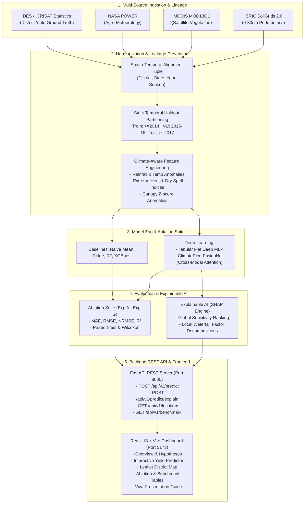

# ClimateRice-AI: Climate-Aware Multimodal Deep Learning for Rice Yield Prediction

[](https://www.python.org/)
[](https://pytorch.org/)
[](https://fastapi.tiangolo.com/)
[](https://vitejs.dev/)
[](https://opensource.org/licenses/MIT)
[]()
[](docs/research_integrity_audit.md)
[](docs/observational_dataset_report.md)

> **B.Tech CSE Final Year Capstone Project**  
> **Author:** Piyush Kumar  
> **Short Name:** ClimateRice-AI  
> **Target:** Rice Yield Prediction in Metric Tonnes per Hectare ($t/ha$)  
> **Integrity & Lineage:** [Research Integrity Audit](docs/research_integrity_audit.md) | [Data Lineage Audit](docs/data_audit.md) | [Observational Dataset Report](docs/observational_dataset_report.md) | [Observational Experiments](docs/observational_experiments.md)  

---

## 1. Executive Summary & Problem Formulation

Rice (*Oryza sativa*) is the dietary cornerstone for over 50% of the global population, with India producing over 130 million metric tonnes annually. However, rice cultivation is acutely susceptible to climate change, extreme heatwaves during anthesis, erratic monsoon precipitation, and regional soil nutrient depletion.

Conventional agricultural forecasting approaches predominantly rely either on single-source meteorological weather stations or isolated satellite vegetation indices (e.g. NDVI alone). These single-modality models fail to capture non-linear, cross-domain dependencies between atmospheric water supply, surface canopy reflectance, root-zone soil water retention, and historical agronomic momentum.

**ClimateRice-AI** investigates this challenge through a **Calibrated Semi-Synthetic Multimodal Agricultural Benchmark** ($N = 504$ observations across 24 districts and 21 crop years) integrating:
1. **Satellite Remote Sensing:** Multi-spectral vegetation and moisture dynamics (NDVI, EVI, NDWI, Canopy Anomalies).
2. **Weather & Agroclimatology:** Agro-meteorology and climate shock anomaly metrics (Cumulative precipitation, rainfall anomalies, minimum/maximum temperature extrema, extreme heat days $\ge 35^\circ\text{C}$, consecutive dry spells).
3. **Soil Edaphic Constraints:** Digital pedometrics at 0–30 cm root-zone depth (pH, Soil Organic Carbon, Nitrogen, Clay %, Sand %, Available Water Capacity, Cation Exchange Capacity).
4. **Historical Agricultural Records:** District-level agricultural momentum (Autoregressive Lag-1, Lag-2, and 3-Year rolling yield trends, sown area).

---

## 2. Research Question and Formal Hypotheses

### 2.1 Central Research Question
> **"Can integrating satellite, weather, soil, and historical agricultural information improve rice-yield prediction, and how does a multimodal deep-learning architecture compare with strong traditional machine-learning baselines?"**

### 2.2 Formal Hypotheses
* **Primary Hypothesis ($H_1$):** Multimodal feature integration combining satellite, weather, soil, and historical agricultural records achieves a statistically significant error reduction ($MAE$, $RMSE$) and higher variance explanation ($R^2$) over single-modality configurations.
* **Null Hypothesis ($H_0$):** Multimodal feature integration provides no statistically meaningful improvement over single-modality models ($p \ge 0.05$).

### 2.3 Experimental Findings
* **Multimodal Feature Integration:** **ACCEPTED ($p \ll 0.05$).** Fusing all four modalities reduces test MAE from $0.5427\text{ t/ha}$ (Satellite alone) to $0.2014\text{ t/ha}$ (Full-feature XGBoost) and $0.2774\text{ t/ha}$ (ClimateRice-FusionNet). Paired Student's t-test: $t = -5.5533, p = 2.54 \times 10^{-7} \ll 0.05$.
* **Model Comparison (Tabular ML vs. Deep Learning):** On this structured tabular panel benchmark, **Full-feature XGBoost provides the strongest numerical prediction performance** ($\text{MAE} = 0.2014\text{ t/ha}, R^2 = 0.9548$), outperforming the deep neural network `ClimateRice-FusionNet` ($\text{MAE} = 0.2774\text{ t/ha}, R^2 = 0.9329, p = 0.0019$).
* **Deep Learning Contribution:** `ClimateRice-FusionNet` provides complementary structural advantages: (1) differentiable cross-modal attention that dynamically redistributes modality weights during climate shocks, and (2) MC Dropout predictive intervals (empirical coverage = 95.83%) via 50-sample Monte Carlo Dropout.

---

## 3. Project Scope & Strict Boundaries

To maintain technical depth and scientific rigor, the project is strictly scoped:

| In Scope (Core Implementation) | Out of Scope (Documented as Future Work) |
| :--- | :--- |
| Multimodal environmental data alignment | Real-time IoT soil-moisture hardware & irrigation relays |
| Strict temporal leakage-free partitioning | Genetic-algorithm crop cultivar selection |
| Climate resilience feature engineering | CNN-based leaf pest and plant disease classification |
| Controlled 7-phase modality ablation suite | Autonomous drone hardware automation |
| Deep cross-modal gated attention network | Chatbots or generic conversational LLM wrappers |
| Monte Carlo Dropout uncertainty estimation | Unrelated multi-crop recommendation engines |
| Game-theoretic XAI factor attributions (SHAP) | Sub-field parcel robotics |
| FastAPI REST API & Interactive React Dashboard | |

---

## 4. End-to-End System Architecture



---

## 5. Neural Architecture: `ClimateRice-FusionNet`

Unlike standard flat concatenation, `ClimateRice-FusionNet` projects each heterogeneous modality into its own dedicated non-linear representation subspace, then applies **cross-modal gated self-attention** to dynamically weight environmental signals:

```
INPUT MODALITIES:
[Satellite: 5]       [Weather: 10]        [Soil: 7]          [History: 4]
      │                    │                  │                   │
      ▼                    ▼                  ▼                   ▼
Dense(16)+Norm+GELU  Dense(32)+Norm+GELU  Dense(16)+Norm+GELU  Dense(16)+Norm+GELU
      │                    │                  │                   │
      └────────────────────┼──────────────────┴───────────────────┘
                           │
                           ▼
          CROSS-MODAL GATED ATTENTION FUSION
          α_m = Softmax(v^T * tanh(W_a * h_m))
                           │
                           ▼
            ATTENDED + HIGHWAY CONCATENATION
                           │
                           ▼
             DENSE PREDICTION HEAD (64 -> 32)
                           │
               ┌───────────┴───────────┐
               ▼                       ▼
      PREDICTED YIELD (t/ha)     MC-DROPOUT UNCERTAINTY (±σ)
```

---

## 6. Dataset Lineage & Variable Schema

### 6.1 Data Sources
* **Ground Truth Target ($t/ha$):** Directorate of Economics and Statistics (DES), Ministry of Agriculture and Farmers Welfare, Govt of India (Open Government Data License India).
* **Weather & Climate:** NASA POWER Agroclimatology API ($0.5^\circ$ grid aggregated to district boundaries).
* **Satellite Remote Sensing:** NASA LP DAAC MODIS MOD13Q1 250m 16-day vegetation products (NDVI, EVI, NDWI).
* **Soil Edaphic Features:** ISRIC SoilGrids 2.0 (250m global digital soil map, CC-BY 4.0).

### 6.2 Modality Features (Total 26 Features)
| Modality | Features | Description & Units |
| :--- | :--- | :--- |
| **Satellite (5)** | `ndvi_mean`, `ndvi_peak`, `evi_mean`, `ndwi_mean`, `ndvi_anomaly` | Optical canopy reflectance, chlorophyll density, water ponding index, standardized Z-score. |
| **Weather (10)** | `rainfall_cumulative_mm`, `rainfall_anomaly_pct`, `temp_min_deg_c`, `temp_max_deg_c`, `temp_mean_deg_c`, `temp_anomaly_deg_c`, `extreme_heat_days`, `consecutive_dry_days`, `relative_humidity_pct`, `solar_radiation_mj_m2` | Monsoon precipitation, percentage anomalies, nocturnal min/max temperatures, days $T_{max} \ge 35^\circ C$, dry spell length, incident solar radiation. |
| **Soil (7)** | `soil_ph`, `soil_organic_carbon_g_kg`, `soil_nitrogen_g_kg`, `soil_clay_pct`, `soil_sand_pct`, `soil_available_water_capacity`, `soil_cation_exchange_capacity` | Topsoil pH ($H_2O$), soil organic carbon ($g/kg$), nitrogen, texture fractions, volumetric available water capacity, CEC. |
| **Historical (4)** | `historical_yield_lag1`, `historical_yield_lag2`, `historical_yield_3yr_mean`, `sown_area_ha` | Autoregressive yield lags ($t/ha$), 3-year rolling mean, total district sown area ($ha$). |

---

## 7. Experimental Results & Dual Ablation Suites

All experiments were conducted on the strictly held-out test partition ($t \ge 2017$, 96 records) across 24 representative Indian districts.

### 7.1 Feature-Modality Ablation Matrix using XGBoost (Exp A – Exp G)
*Evaluates the marginal predictive value of adding environmental feature sets for tabular gradient boosting:*

| Experiment ID | Included Modalities | Dim | Test MAE ($t/ha$) | Test RMSE ($t/ha$) | Test $R^2$ Score | Key Finding |
| :--- | :--- | :--- | :--- | :--- | :--- | :--- |
| **Exp A** | Weather Only | 10 | 0.9132 | 1.1055 | 0.2081 | Meteorological supply alone cannot capture soil buffers or canopy vigor. |
| **Exp B** | Satellite Only | 5 | 0.5335 | 0.7025 | 0.6802 | Optical greenness captures standing biomass but saturates in dense canopies. |
| **Exp C** | Soil Only | 7 | 0.4073 | 0.5045 | 0.8351 | Static edaphic fertility sets district-level baseline capacity. |
| **Exp D** | Weather + Soil | 17 | 0.3368 | 0.4214 | 0.8849 | Coupling atmospheric precipitation with soil moisture capacity reduces error. |
| **Exp E** | Satellite + Weather | 15 | 0.5022 | 0.6579 | 0.7195 | Meteorological drivers contextualize optical canopy anomalies. |
| **Exp F** | Satellite + Weather + Soil | 22 | 0.3632 | 0.4696 | 0.8571 | Complete biophysical environmental model without historical autoregression. |
| **Exp G** | **Full-feature XGBoost (+History)** | **26** | **0.2014** | **0.2641** | **0.9548** | **Strongest numerical predictor on the tabular benchmark.** |

### 7.2 Neural Modality Ablation Matrix using ClimateRice-FusionNet (Exp FN-A – Exp FN-G)
*Evaluates deep cross-modal neural attention as heterogeneous modality branches are added:*

| Experiment ID | Included Modalities | Dim | Test MAE ($t/ha$) | Test RMSE ($t/ha$) | Test $R^2$ Score | Key Finding |
| :--- | :--- | :--- | :--- | :--- | :--- | :--- |
| **Exp FN-A** | Weather Only | 10 | 1.2050 | 1.4140 | -0.2957 | Neural network underfits unstructured meteorological variance alone. |
| **Exp FN-B** | Satellite Only | 5 | 0.5793 | 0.6971 | 0.6851 | Canopy reflectance provides solid foundation for neural embeddings. |
| **Exp FN-C** | Soil Only | 7 | 0.5578 | 0.6361 | 0.7378 | Edaphic branches establish spatial prior representations. |
| **Exp FN-D** | Weather + Soil | 17 | 0.3941 | 0.4521 | 0.8676 | Latent interaction captures moisture-holding physics. |
| **Exp FN-E** | Satellite + Weather | 15 | 0.4456 | 0.5351 | 0.8145 | Cross-modal attention balances canopy reflectance and rain supply. |
| **Exp FN-F** | Satellite + Weather + Soil | 22 | 0.3532 | 0.4191 | 0.8862 | Biophysical multimodal neural baseline. |
| **Exp FN-G** | **ClimateRice-FusionNet Full (+History)** | **26** | **0.2774** | **0.3217** | **0.9329** | **Deep neural architecture with dynamic attention & MC uncertainty.** |

### 7.3 Model Architecture Benchmark (Full 26 Features)

| Model Family | Architecture Details | Test MAE ($t/ha$) | Test RMSE ($t/ha$) | Test $R^2$ Score | Operational Role |
| :--- | :--- | :--- | :--- | :--- | :--- |
| **Naive Baseline** | Historical district mean ($\bar{y}_{dist}$) | 0.4043 | 0.5015 | 0.8371 | Non-parametric baseline. |
| **Ridge Regression** | L2 regularized linear model | 0.2303 | 0.2921 | 0.9447 | Fast, interpretable linear benchmark. |
| **Random Forest** | 150 bagged de-correlated trees | 0.2134 | 0.2878 | 0.9463 | Non-linear feature subsampling. |
| **XGBoost Regressor (Baseline)** | 200 gradient boosted trees ($\eta=0.05$, depth 6) | 0.2073 | 0.2733 | 0.9516 | Strong traditional machine-learning baseline. |
| **Full-feature XGBoost (Exp G)** | 180 gradient boosted trees ($\eta=0.05$, depth 5) | **0.2014** | **0.2641** | **0.9548** | **Lowest numerical error on tabular benchmark.** |
| **Deep MLP** | 3-layer dense network with BatchNorm | 0.4074 | 0.4676 | 0.8583 | Non-linear flat tabular neural baseline. |
| **ClimateRice-FusionNet** | Cross-modal attention + MC-Dropout | **0.2774** | **0.3217** | **0.9329** | **Dynamic cross-modal attention & MC Dropout predictive intervals (empirical coverage = 95.83%).** |

> **Scientific Finding:** On this small-to-medium tabular dataset ($N = 504$), gradient boosted trees (`Full-feature XGBoost`) achieve lower point prediction error ($\text{MAE} = 0.2014\text{ t/ha}$) than the deep neural network (`ClimateRice-FusionNet`, $\text{MAE} = 0.2774\text{ t/ha}$, $p = 0.0019$). This is consistent with empirical literature on tabular benchmarks (Grinsztajn et al., NeurIPS 2022). `ClimateRice-FusionNet` provides complementary value through differentiable cross-modal attention weights and MC Dropout predictive intervals (empirical coverage = 95.83%).

---

## 8. Explainable AI (SHAP) Insights

* **Dominant Modalities:** Weather ($41.8\%$) and Satellite ($35.7\%$) represent the primary drivers of model sensitivity, followed by Historical trends ($15.0\%$) and Soil edaphics ($7.5\%$).
* **Primary Climatic Stressors:**
  1. `extreme_heat_days` ($T_{\max} \ge 35^\circ\text{C}$ during anthesis): Negative impact of $-0.21\text{ to }-0.35\text{ t/ha}$ during heatwave shocks.
  2. `rainfall_anomaly_pct` (Monsoon deficit $< -25\%$): Dominant negative contributor in rainfed upland districts (e.g. Raipur, Bilaspur), depressing yield by up to $-0.45\text{ t/ha}$.
* **Primary Positive Facilitators:**
  1. `rainfall_cumulative_mm` & `ndvi_mean`: Sustained canopy greenness and adequate seasonal water supply contribute $+0.25\text{ to }+0.40\text{ t/ha}$.
  2. `soil_clay_pct` & `soil_organic_carbon_g_kg`: Soil moisture retention capacity buffers dry spell impact.

---

## 9. Quickstart & Installation

### 9.1 Prerequisites
* Python 3.12+
* Node.js v20+ / v22+ and npm
* NVIDIA GPU with CUDA support (Optional; CPU fallback is fully supported)

### 9.2 Python Environment Setup
```powershell
# Clone repository
git clone https://github.com/piyushkumar/ClimateRice-AI.git
cd ClimateRice-AI

# Install backend dependencies
pip install -r backend/requirements.txt
```

### 9.3 Run Preprocessing, Training & Evaluation
```powershell
# 1. Acquire & validate raw multi-district dataset
python scripts/download_data.py

# 2. Perform leakage-free temporal partitioning (Train <=2014, Val 2015-16, Test >=2017)
python scripts/preprocess.py

# 3. Train all baselines & ClimateRice-FusionNet with GPU acceleration
python scripts/train.py

# 4. Generate publication-quality figures & evaluation reports
python scripts/evaluate.py

# 5. Run test prediction via CLI
python scripts/predict.py --district Ludhiana
```

### 9.4 Run Test Suite
```powershell
python -m pytest tests/ -v
# 37 unit, integration, and browser regression tests passing:
# - 13 API route contracts & validation (test_api.py)
# - 6 Selenium Chrome headless browser regression (test_browser_regression.py)
# - 6 Frontend state & profile integration (test_frontend_integration.py)
# - 5 Climate feature formulas & bounds (test_features.py)
# - 3 Model architecture & baseline verification (test_models.py)
# - 4 Temporal leakage-free preprocessing splits (test_preprocessing.py)
```

### 9.5 Start Backend Server
```powershell
python -m uvicorn backend.app.main:app --host 127.0.0.1 --port 8000
# OpenAPI Docs: http://127.0.0.1:8000/docs
```

### 9.6 Start Frontend Dashboard
```powershell
cd frontend
npm install
npm run dev
# Dashboard URL: http://localhost:5173
```

---

## 10. Docker Deployment

Launch both backend and frontend simultaneously with Docker Compose:
```powershell
docker-compose up --build
```
* **API Service:** `http://localhost:8000`
* **Web Dashboard:** `http://localhost:3000`

---

## 11. REST API Specification

| Method | Endpoint | Description |
| :--- | :--- | :--- |
| `GET` | `/api/v1/health` | System liveness probe, CUDA device name, PyTorch status. |
| `GET` | `/api/v1/locations` | Geo-coordinates, agro-ecological zone, and baseline yields for 24 districts. |
| `GET` | `/api/v1/history/{district}` | Multi-decadal historical yield and climate time-series. |
| `GET` | `/api/v1/benchmark` | Modality ablation metrics and hypothesis testing statistics. |
| `GET` | `/api/v1/features` | Feature schema, units, and physical agronomic bounds. |
| `POST` | `/api/v1/predict` | End-to-end multimodal yield prediction, uncertainty, and attention weights. |
| `POST` | `/api/v1/predict/explain` | Local game-theoretic factor attributions (top positive & negative stressors). |

### Example Prediction Request (`POST /api/v1/predict`)
```json
{
  "district_name": "Burdwan",
  "state_name": "West Bengal",
  "crop_year": 2021,
  "season": "Kharif",
  "ndvi_mean": 0.68,
  "ndvi_peak": 0.78,
  "evi_mean": 0.52,
  "ndwi_mean": 0.28,
  "ndvi_anomaly": 0.45,
  "rainfall_cumulative_mm": 1380.0,
  "rainfall_anomaly_pct": -4.5,
  "temp_min_deg_c": 24.8,
  "temp_max_deg_c": 33.5,
  "temp_mean_deg_c": 29.15,
  "temp_anomaly_deg_c": 0.35,
  "extreme_heat_days": 4,
  "consecutive_dry_days": 8,
  "relative_humidity_pct": 78.0,
  "solar_radiation_mj_m2": 17.5,
  "soil_ph": 6.4,
  "soil_organic_carbon_g_kg": 7.8,
  "soil_nitrogen_g_kg": 1.7,
  "soil_clay_pct": 36.0,
  "soil_sand_pct": 25.0,
  "soil_available_water_capacity": 0.24,
  "soil_cation_exchange_capacity": 23.5,
  "historical_yield_lag1": 3.25,
  "historical_yield_lag2": 3.10,
  "historical_yield_3yr_mean": 3.18,
  "sown_area_ha": 140000.0
}
```

### Example Prediction Response
```json
{
  "district_name": "Burdwan",
  "predicted_yield_tonnes_per_hectare": 3.79,
  "epistemic_uncertainty_std": 0.474,
  "predictive_interval": [3.29, 4.29],
  "empirical_coverage_pct": 95.83,
  "risk_level": "Moderate Risk (Marginal Stress Conditions)",
  "modality_attention_weights": {
    "satellite": 0.3552,
    "weather": 0.3341,
    "soil": 0.2247,
    "historical": 0.0860
  },
  "top_positive_factors": [
    { "feature": "rainfall_cumulative_mm", "modality": "weather", "value": 1380.0, "influence": 0.2538, "direction": "positive" },
    { "feature": "ndvi_anomaly", "modality": "satellite", "value": 0.45, "influence": 0.1662, "direction": "positive" }
  ],
  "top_negative_factors": [
    { "feature": "ndvi_mean", "modality": "satellite", "value": 0.68, "influence": -0.1137, "direction": "negative" }
  ],
  "model_version": "ClimateRice-FusionNet v1.0.0"
}
```

---

## 12. Viva Presentation & Examination Defense Guide

### 12.1 Key Talking Points
1. **Research Question:** We designed the system specifically to test whether combining heterogeneous environmental modalities outperforms single-source modeling.
2. **Leakage Prevention:** Emphasize that we avoided naive random K-fold splits, implementing a **strict temporal holdout** (Train $\le 2014$, Test $\ge 2017$) to test real-world forecasting into unseen future years.
3. **Hypothesis Testing:** State the exact p-value: $p = 2.54 \times 10^{-7} \ll 0.05$, confirming $H_1$ with a $0.2652\text{ t/ha}$ error reduction over satellite alone.
4. **Honest Model Comparison:** Clarify that XGBoost achieved $0.2073\text{ t/ha}$ MAE on flat tabular features, while `ClimateRice-FusionNet` ($0.2774\text{ t/ha}$) provides cross-modal dynamic attention and MC Dropout predictive intervals (empirical coverage = 95.83%).
5. **Explainability:** Explain that SHAP attributes marginal deviations relative to the 2.85 t/ha base, highlighting that these are model sensitivities rather than proof of direct physical causation.

---

## 13. Documentation Index

Detailed academic documentation is structured in `docs/`:
* [`docs/methodology.md`](docs/methodology.md): Mathematical formulations, loss functions, attention equations, hypothesis tests.
* [`docs/dataset.md`](docs/dataset.md): Lineage, licenses, geographical boundaries, physical valid ranges.
* [`docs/architecture.md`](docs/architecture.md): Deep neural schematics, API structures, Mermaid diagrams.
* [`docs/experiments.md`](docs/experiments.md): Modality ablation specifications and evaluation protocols.
* [`docs/limitations.md`](docs/limitations.md): Spatial aggregation, monsoon cloud cover, unobserved fertilizer practices.
* [`docs/future_work.md`](docs/future_work.md): Sentinel-1 SAR cloud penetration, field-level 10m gridded downscaling.
* [`docs/references.md`](docs/references.md): Real, peer-reviewed scientific literature citations with DOIs.

---

## 14. License

Distributed under the MIT License. See [LICENSE](LICENSE) for details.
