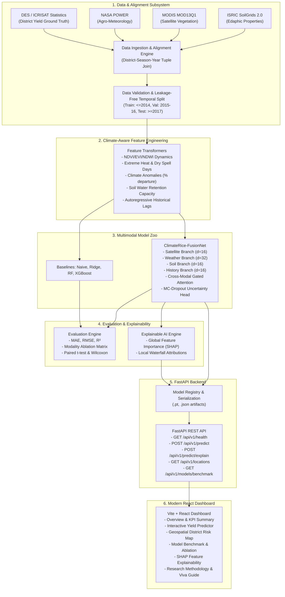
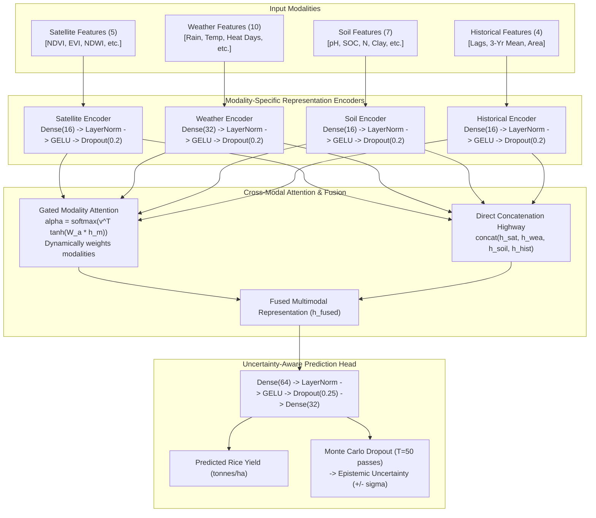

# System Architecture: ClimateRice-AI

## 1. End-to-End System Pipeline

The **ClimateRice-AI** system is architected as a modular, decoupled research and production platform consisting of six primary subsystems:

---

## 2. Neural Architecture: `ClimateRice-FusionNet`

`ClimateRice-FusionNet` addresses the fundamental limitation of standard concatenation by projecting each heterogeneous modality into its own dedicated non-linear representation subspace, followed by a multi-head gated cross-modal attention mechanism:

---

## 3. Backend API Architecture (FastAPI)

The backend provides high-performance asynchronous endpoints powered by Pydantic V2 data validation:

* `GET /health` / `GET /api/v1/health`: Liveness and readiness probe, returning server status, GPU/CPU execution device, and active model versions.
* `GET /api/v1/locations`: Returns geographical and agro-climatic metadata for all supported Indian districts (centroid coordinates, state, baseline historical yield).
* `GET /api/v1/history/{district_name}`: Returns time-series historical records of rice yield, climate anomalies, and vegetation indices for a specific district.
* `POST /api/v1/predict`: Accepts multimodal environmental parameters and returns predicted yield ($t/ha$), risk category (`Low Risk`, `Moderate Risk`, `High Risk`), and calibrated uncertainty intervals.
* `POST /api/v1/predict/explain`: Computes local SHAP attributions and returns positive and negative feature influences for an individual prediction.
* `GET /api/v1/models/benchmark`: Returns the comparative evaluation metrics ($MAE, RMSE, R^2$) across all baselines and modality ablation experiments.

---

## 4. Frontend Architecture (React + Vite + Leaflet + Recharts)

The frontend is structured into modular responsive components:
1. **Executive Overview Page:** Real-time metrics overview, research summary, key performance indicators, and dataset coverage metrics.
2. **Yield Prediction Studio:** Interactive environmental slider and input panel allowing users to simulate climate shock scenarios (e.g. $+3^\circ C$ temperature anomaly, $-30\%$ monsoon deficit) and observe predicted yield and uncertainty response in real time.
3. **Geospatial District Risk Map:** Interactive Leaflet choropleth map plotting Indian districts with color-coded yield potential and climate vulnerability indicators.
4. **Model Performance & Ablations:** Interactive comparison charts plotting the 7 controlled modality ablation experiments alongside traditional baselines.
5. **Explainable AI (SHAP) Explorer:** Global beeswarm and waterfall attribution plots detailing feature contributions.
6. **Academic Viva & Methodology:** Interactive walkthrough of problem statement, mathematical derivations, literature references, and defense guidelines.
